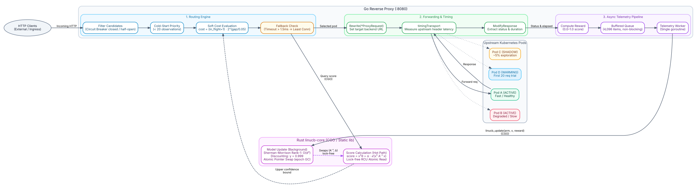

# Project Janus

**A load balancer that learns which of your servers is having a bad day.**

A load balancer decides which backend gets each request. Most take turns (round robin)
or pick the backend with the fewest open connections. That works until one backend
quietly gets slow, starts returning errors, or runs out of CPU: the simple policies keep
sending it its full share, and your slowest requests all land there.

Janus watches every response (how long it took, whether it failed, how busy the pod is),
keeps a small statistical model per backend, and steers traffic away from a struggling
backend within moments. When the backend recovers, traffic comes back.

It is a *contextual bandit* (LinUCB) in Rust, wrapped by a Go reverse proxy, shipped as
one binary for Kubernetes. This repository is both the system and the experiment that
asks whether the idea beats the classics.

---

## The headline

On a controlled testbed, with one backend deliberately broken for 10 seconds at a time,
Janus cut p99 latency by **4× to 90×** against four classic policies, and its failure
rate dropped from 5% to 0.07% when a backend returned errors.

Median p99 during the fault, in milliseconds (log-scaled bars, shorter is better), from
120 trials over 6 seeds:

```
+200 ms latency fault
  Janus      8.4 ms  ██████
  LC        14.1 ms  ███████
  Peak EWMA 29.4 ms  █████████
  P2C        203 ms  ██████████████
  RR       2,002 ms  ████████████████████   (2 s client timeouts)

CPU-starved backend
  Janus      7.0 ms  █████
  Peak EWMA 31.1 ms  █████████
  LC         95 ms   ████████████
  P2C        98 ms   ████████████
  RR        246 ms   ██████████████
```

| Janus vs. | Fault-phase p99 ratio | 95% interval | Pass mark |
| --- | --- | --- | --- |
| Round robin | **0.011×** | 0.009–0.013 | below 0.85 |
| Least connections | **0.21×** | 0.18–0.24 | below 0.85 |
| Power of two choices | **0.056×** | 0.047–0.065 | below 0.85 |
| Peak EWMA | **0.25×** | 0.22–0.30 | below 0.85 |

Nothing was lost to get there: healthy throughput was 599.9 requests/s for every policy,
and healthy p99 was 4.12 ms against 3.94–4.00 ms for RR, LC and P2C.

**It did not start this way.** In October, against the same three smarter baselines,
Janus *lost* every gate: its fault p99 was 13× (P2C) and 26× (Peak EWMA) *worse*, and
its throughput fell short. Getting from there to here took six weeks and a rebuild.
That story is the interesting part of this repository.

---

## The research story

| When | What happened | Result |
| --- | --- | --- |
| Sep 2026 | First benchmark against RR and LC | Won on latency and CPU faults (p99 4 ms vs 204 ms), but capacity collapsed (Janus passed 600–700 RPS where the baselines passed 1,200) and 503 handling was erratic |
| Oct 2026 | Pre-registered study against P2C and Peak EWMA | **Lost every gate.** The cause was not isolated |
| Nov 8–9 | Post-hoc analysis | Baseline tails were mostly CPU throttling; Janus's collapse matched a hard score cutoff that herded traffic |
| Nov 9–10 | Rebuild: new reward, soft routing, cold-start fixes, black-box harness | Local smoke runs found real bugs that unit tests could not |
| Nov 10 | Frozen campaign, 120 trials | **Passed every gate against all four baselines**, but lost the recovery phase (1.9–6.5× worse), which no gate covered |
| Nov 11 | Recovery fixes, exploratory 30 s recovery study | Recovery p99 matched RR, LC and P2C; the recovered pod regained its fair 25% share |

The two October and November comparisons are not like-for-like (the harness, baselines
and workload changed), so read the arc as "what we learned", not as one metric improving.
The full account, failures included, is in [`docs/history.md`](docs/history.md).

---

## Architecture at a glance



```
 clients ──▶ Go proxy :8080
                │
                ├─ 1. candidates: every pod whose circuit breaker is closed
                ├─ 2. any pod with < 20 observations?  → try it first
                ├─ 3. LinUCB score per pod (Rust, lock-free read)
                ├─ 4. cost = (in flight + 1) · 2^steps(score gap); pick the cheapest, random ties
                ├─ 5. decision > 1.5 ms, or nothing to choose?  → least-connections fallback
                └─ 6. ~5% of requests → SHADOW pods
                │
                ▼
         ReverseProxy ──▶ backend pod
                │
                └─ response: measure latency, compute a 0–1 reward, enqueue (never blocks)
                       └─ single worker ──▶ Rust FFI: Sherman-Morrison update, O(d²)
```

| Layer | Language | Role |
| --- | --- | --- |
| `linucb-core/` | Rust | LinUCB maths, per-pod models, lock-free (RCU) state, C ABI |
| `linucb-proxy/` | Go | Reverse proxy, routing, pod lifecycle, telemetry, Kubernetes discovery |
| `benchmark/` | Go (separate module) | Black-box harness; runs the unmodified Janus binary against four baselines |
| `helm-chart/` | Helm | Kubernetes deployment |

### Design decisions, and the evidence behind each

Most of these exist because something broke. Each one links a decision to a measured
reason.

| Decision | Why | Evidence |
| --- | --- | --- |
| **Rust core, Go proxy, joined by CGO into one static binary** | Go suits the networking and Kubernetes shell; Rust suits the numeric hot path with no GC pauses. A static library means no `.so` to ship | Model update measured at 436 ns (target: under 50 µs) |
| **Sherman-Morrison rank-one updates** | Update the inverse directly instead of re-inverting: about 290 operations per request instead of about 1,700 at 12 features | Numerical stability test holds over 100,000 updates (error under 1e-6) |
| **Discounted LinUCB (γ = 0.999)** | Plain LinUCB has inertia: after 70,000 good requests it took minutes of 500 ms delay and still sent over 99% of traffic to the degraded pod | Observed directly in early testing |
| **Lock-free reads via RCU and epoch GC** | Scoring runs on every request; a mutex would queue readers behind each other and behind GC pauses | Readers see a consistent `(A⁻¹, b)` pair; concurrent-reader tests |
| **A lower score is a load penalty, not an exclusion** | A hard "within 0.05 of the best" cutoff herded traffic onto one pod when scores were noisy | Healthy p99 about 2 s and capacity collapse before; none after |
| **Dead zone, random ties, random rounding** | With smooth gaps the top-scoring pod took every request that found it idle (about 260 req/s on a pod that serves 250) and got CPU-throttled | Simulated healthy p99 27 ms → 2 ms; local smoke 44–53 ms → 4.3 ms. Random rounding targets the 0%↔33% share swing seen on a recovering pod |
| **Score every pod, give each new pod 20 requests first** | Holding unproven pods to a small share deadlocked cold start (no pod ever reached ACTIVE) and left late joiners warming for about 50 s | Frozen campaign: all pods ACTIVE after warmup in every trial |
| **Expire stale latency; catch up idle arms on update** | A routed-around pod kept its fault-era p99 and never got traffic to disprove it | Recovered pod got **0 of 1,800** requests before; settles at 0.249–0.250 share after |
| **Any 5xx gives reward 0; leaky-bucket circuit breaker** | A 5xx used to earn +0.10 through the CPU term; a breaker that reset on every success missed intermittent errors | Errors fault: 4 failures in 6,000 requests vs 300 for RR, LC and P2C |
| **Black-box benchmark with a frozen protocol** | To stop us tuning Janus to a friendly test: separate module, production binary, pre-committed decision rule, no filtered trials | Protocol frozen 2026-11-10, before the first trial |

---

## How trustworthy is this?

The design is deliberately rigorous: a dedicated 4-vCPU VM with cgroup-enforced CPU
limits (proxy 1.0 CPU; four backends at 0.25 CPU), an open-loop generator that measures
latency from each request's *scheduled* arrival so queueing can't hide, six seeds,
shuffled order, a paired bootstrap, and validity checks that flag but never filter.

And the limits are real, so quote them with the result:

- **Janus has circuit breakers; the baselines do not.** Part of the failure-rate win is the breaker, not the learning.
- **Janus loses some metrics.** With a backend returning errors, its p99 is about 9.5 ms against about 4 ms for RR, LC and P2C. It takes 1.5–2.3 s to trust a recovered backend (the others take 1.0 s) and uses about 25–33% more proxy CPU per request.
- **RR's number is a ceiling, not a tail.** It is capped by 2-second client timeouts.
- **The recovery result is exploratory.** The fixes were written after seeing the first results and tested once, with no repeat.
- **It is a synthetic, friendly workload.** Evenly spaced requests at 600 RPS, one VM, short faults, identical requests, and Janus was tuned on this testbed. Nothing here covers bursty traffic, multi-node networks, Kubernetes discovery or production load.

Details and the exact numbers are in [Testing and benchmarking](docs/12-testing-and-benchmarking.md);
what is still open is in [Known issues](docs/known-issues.md).

---

## Quick start

You need Rust 1.75+, Go 1.24+ and CGO enabled. Build the Rust core first; the Go proxy
links its static library.

```bash
(cd linucb-core && cargo build --release)
(cd linucb-proxy && go build -o proxy ./cmd/proxy/)

# two throwaway backends, in other terminals
python3 -m http.server 9001
python3 -m http.server 9002

cd linucb-proxy && ./proxy -listen=:8080
```

```bash
curl -s localhost:8080/ >/dev/null
curl localhost:8080/stats    # requests per pod
curl localhost:8080/model    # per-pod state and scores (JSON)
```

Kubernetes (Helm), Docker, flags and tuning: [Running Janus](docs/10-running-janus.md).

```bash
(cd linucb-core && cargo test)
(cd linucb-proxy && go test ./...)
```

---

## Where to read next

Start at [`docs/README.md`](docs/README.md). The pages are written to be read in order,
but each stands alone.

| Page | What it gives you |
| --- | --- |
| [1. The big picture](docs/01-the-big-picture.md) | The problem, why simple policies miss it, and what a bandit is, in plain words |
| [2. How Janus learns](docs/02-how-janus-learns.md) | The score formula, the cheap update, and why new pods need special care |
| [3. What Janus measures](docs/03-what-janus-measures.md) | The 12 features and the 0–1 reward formula, with worked examples |
| [4. The life of a request](docs/04-life-of-a-request.md) | Startup, then one request from arrival to learning, and why routing works the way it does |
| [5. Pods and their lifecycle](docs/05-pods-and-lifecycle.md) | How Janus finds backends and how a new pod earns its place |
| [6. Adapting to change](docs/06-adapting-to-change.md) | Forgetting, recovery after a fault, and the bugs that taught us both |
| [7. Safety nets](docs/07-safety-nets.md) | The circuit breaker and the least-connections fallback |
| [8. The Rust core and FFI](docs/08-rust-core-and-ffi.md) | Lock-free state and the Rust-to-Go bridge (the most technical page) |
| [9. The Go proxy](docs/09-go-proxy-internals.md) | The reverse proxy, request timing, telemetry and the feature store |
| [10. Running Janus](docs/10-running-janus.md) | Laptop, Kubernetes and Docker; every flag and Helm value; tuning; what happens on restart |
| [11. Troubleshooting](docs/11-troubleshooting.md) | Symptom, cause and fix |
| [12. Testing and benchmarking](docs/12-testing-and-benchmarking.md) | The test suites, the benchmark design, its results and how to rerun it |
| [13. Reference](docs/13-reference.md) | Source file map and glossary |
| [Known issues and risks](docs/known-issues.md) | What is still broken or unproven, most important first |
| [History](docs/history.md) | September to November: what was tried, what failed and why each decision was made |
| [Benchmark harness](benchmark/README.md) | The black-box harness, its frozen protocol and the raw results |

**Short on time?** Read page 1, then page 4. **Deploying it?** Pages 10 and 11, then the
known issues. **Judging the evidence?** Page 12, then the history.
