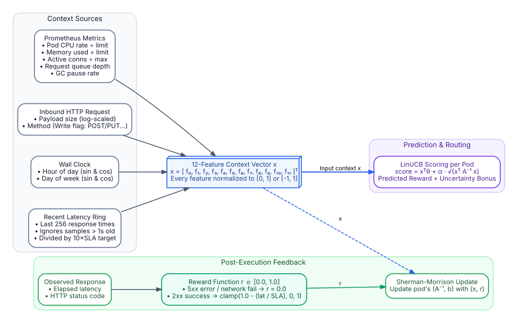

# 3. What Janus measures

**What you'll learn:** the 12 numbers Janus looks at when it scores a pod (the
"context"), and the formula that turns a finished request into a 0–1 reward.

---

## Part A: the context (12 features)



When Janus scores a pod it builds a vector of 12 numbers describing the situation:
some about the pod, some about the request, some about the clock.

### Why every feature is squeezed into a small range

The model is linear. If one feature ranged from 0 to 1 and another from 0 to 100,000
(say, latency in microseconds), the big one would drown out the rest. So every
feature is scaled to `[0, 1]` (or `[−1, 1]` for the clock features) so each one
contributes comparably.

### The 12 features

| # | Feature | Range | Why it's useful |
| --- | --- | --- | --- |
| 0 | Pod CPU utilisation | [0, 1] | 1-minute CPU rate ÷ configured limit. A saturated CPU means slow responses |
| 1 | Pod memory saturation | [0, 1] | Used ÷ limit. Predicts OOM kills and GC pressure |
| 2 | Active connections | [0, 1] | Current ÷ max. A full connection pool means queueing |
| 3 | Request queue depth | [0, 1] | Current ÷ capacity. A deep queue means long waits |
| 4 | GC pause rate | [0, 1] | 1-minute rate of GC pause time |
| 5 | Request payload size | [0, 1] | `log(bytes) / log(16 MiB)`; the log spreads attention across sizes |
| 6 | Is it a write? | {0, 1} | 1 for POST/PUT/PATCH/DELETE; writes are usually slower |
| 7–8 | Hour of day | [−1, 1] | `sin` and `cos` of `2π·hour/24` |
| 9–10 | Day of week | [−1, 1] | `sin` and `cos` of `2π·day/7` |
| 11 | Recent p99 latency | [0, 1] | See below |

Features 0–4 need **Prometheus** (see [Running Janus](10-running-janus.md)). Without it
they stay at zero and Janus learns from latency and errors alone.

### Feature 11: recent p99 latency

This is the model's most important signal. For each pod Janus keeps the last 256
response times, **ignoring any older than 1 second**, takes the 99th percentile,
divides by `10 × SLA target`, and clamps it to `[0, 1]`. If a pod has not answered in a
whole second, the feature resets to 0. (Page 6 explains why that reset matters.)

### Two small tricks worth knowing

**Log scale for payload size.** Without it, 1 KB looks like zero next to 16 MB:

```
1 KB  → log(1024)    / log(16M) ≈ 0.42
1 MB  → log(1048576) / log(16M) ≈ 0.83
16 MB → 1.0
```

**Sin/cos for time.** If you fed in the raw hour (0–23), the model would think 23:00
and 00:00 are far apart. On a clock, they are adjacent. A `sin`/`cos` pair places
each hour on a circle so neighbours stay neighbours. You need both, since `sin` alone
is ambiguous (`sin(x) = sin(π − x)`).

---

## Part B: the reward

After each response, Janus turns "what happened" into one number between 0 and 1.

### Why not just use latency?

Raw latency makes a bad reward:

1. **Unbounded.** A timeout can be 10,000 ms and swamp everything.
2. **Heavy-tailed.** A few spikes distort the average.
3. **Wrong direction.** The model maximises, but you want latency *low*.
4. **No scale.** "Good" depends on your service.

So Janus uses a bounded, normalised reward with three ingredients.

### Ingredient 1: latency score

```
if observed ≤ SLA:   latency_score = 1 − 0.5 · observed / SLA
if observed > SLA:   latency_score = 0.5 · exp(−λ · (observed − SLA))
```

With an SLA of 100 ms and `λ = 0.01`:

| Latency | Score |
| --- | --- |
| 0 ms | 1.00 |
| 50 ms | 0.75 |
| 100 ms | 0.50 |
| 200 ms | 0.18 |
| 500 ms | 0.009 |

It falls linearly up to the SLA and then decays exponentially. It is continuous at
the SLA and always decreasing. The linear part matters: an earlier version was flat
below the SLA, so a 5 ms pod and a 90 ms pod looked identical and the model could
not prefer the faster one.

### Ingredient 2: the error gate

```
error_ok = 1 if status < 500, else 0
```

A 5xx is a failure, not a slow success. It's binary because error codes don't
reliably indicate severity, and a failure is a failure. Connection failures count
too.

### Ingredient 3: CPU headroom

```
cpu_score = clamp(1 − max(0, cpu − 0.85) / 0.15, 0, 1)
```

No penalty up to 85% CPU, then a straight-line drop to zero at 100%. It is a gentle
early warning: CPU saturation tends to show up *before* latency does.

### Putting them together

```
r = 0.70 · latency_score · error_ok
  + 0.20 · error_ok
  + 0.10 · cpu_score

r = 0 for any HTTP status ≥ 500
```

The result is always in `[0, 1]`: the three terms are bounded by 0.70, 0.20 and 0.10,
which sum to exactly 1. The weights say, in order of priority: latency first, not
failing second, CPU as a leading indicator third.

### Worked examples

| Situation | Latency | Status | CPU | Reward |
| --- | --- | --- | --- | --- |
| Fast, healthy pod | 50 ms | 200 | 30% | 0.825 |
| Slow pod | 500 ms | 200 | 30% | ≈ 0.31 |
| Pod returning an error | 100 ms | 500 | 30% | 0 |
| Busy pod | 100 ms | 200 | 90% | ≈ 0.62 |

### How this connects to routing

Across 0–100 ms the reward spans 1.0 → 0.65, so a gap of 0.05 in score corresponds to
roughly a 14 ms difference in latency. That 0.05 is the `ScoreDelta` the router uses
on [page 4](04-life-of-a-request.md): about 14 ms is the point at which Janus starts to
treat one pod as meaningfully worse.

### Where the code lives

The production reward is in Go (`linucb-proxy/internal/proxy/reward.go`). The Rust
engine only receives the finished number, which avoids crossing the language boundary
for every event. The Rust simulator keeps its own copy in
`linucb-core/tests/common/reward.rs`, and **the two must be kept in step by hand**.

---

[← Previous: How Janus learns](02-how-janus-learns.md) · [Documentation index](README.md) · [Next: The life of a request →](04-life-of-a-request.md)
