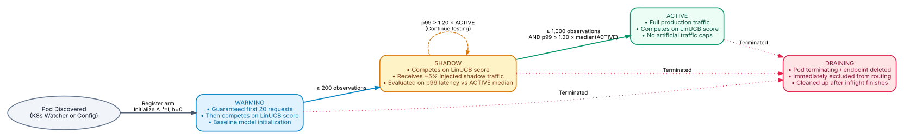

# 5. Pods and their lifecycle

**What you'll learn:** how Janus finds your backends, and how a new pod earns its
place in the fleet.

---

## Part A: finding backends (discovery)

Janus has to know which pods exist. It supports two modes, chosen by one flag.

| Mode | How to select | Use it for |
| --- | --- | --- |
| **Kubernetes** | `-service=my-svc` (build with `-tags k8s`) | Real clusters; pods appear and disappear automatically |
| **Mock** | no `-service` | Local development and tests; backends come from `-backends=id=host:port,...` |

### Kubernetes discovery, step by step

Code: `linucb-proxy/internal/registry/discovery_k8s.go`.

1. Janus starts with `-service=my-backend-service`.
2. It reads the in-cluster service-account token and API-server address.
3. It creates a Kubernetes client and a **shared informer**, filtered to your namespace and to the label `kubernetes.io/service-name=<service>`.
4. It watches **EndpointSlices** for that Service.
5. On every add, update or delete it reads the pod name (`TargetRef.Name`) and address (`Addresses[0]:port`), then calls the registry to add or remove the pod.
6. New pods begin the lifecycle below.

Only endpoints marked **ready** are added:

```go
if endpoint.Conditions.Ready == nil || !*endpoint.Conditions.Ready {
    continue
}
```

**Why EndpointSlices?** Kubernetes splits a Service's endpoints into slices of up to
100. Updating one pod touches one slice, so large Services put far less load on the
API server than the older single `Endpoints` object (deprecated as of Kubernetes 1.33).

**What permissions does it need?** `get`, `list` and `watch` on `endpointslices`
(`discovery.k8s.io`). The Helm chart sets this up; you can check it with:

```bash
kubectl -n janus auth can-i list endpointslices --as=system:serviceaccount:janus:janus
```

### Why two build modes?

The Kubernetes client library is large. A build tag keeps it out of simple builds:

- `discovery_k8s.go` has `//go:build k8s`: real discovery.
- `discovery_k8s_stub.go` has `//go:build !k8s`: a stub that returns an error.

Both satisfy a one-method interface (`Run(ctx)`), so tests and local runs never need a cluster.

> If you pass `-service` and still see "mock discovery enabled", you built without
> `-tags k8s`.

---

## Part B: the pod lifecycle

Every pod moves through states. Think of it as a trial period.



```
WARMING ── 200 observations ──▶ SHADOW ── 1,000 observations AND latency OK ──▶ ACTIVE

(DRAINING: the pod is terminating; it is excluded at once and removed shortly after)
```

| State | Gets traffic by… | Promotion rule |
| --- | --- | --- |
| **WARMING** | Its first 20 requests, then competing on score like everyone else | `≥ 200` observations → SHADOW |
| **SHADOW** | Competing on score, plus ~5% injected shadow traffic | `≥ 1,000` observations **and** p99 within 20% of the ACTIVE median → ACTIVE |
| **ACTIVE** | Competing on score; no cap | — |
| **DRAINING** | Nothing; it is being removed | — |

Defaults live in `registry.Config` (`WarmupObservations 200`, `ShadowObservations 1000`,
`ShadowLatencyTolerancePct 20`, a 1 s promotion check) and `proxy.Config`
(`ShadowTrafficCapPct 5`).

### Why score pods in every state?

Early versions held unproven pods to a small fixed share of traffic. That failed twice:

- **Cold start deadlock.** The first pods to reach SHADOW carried all the load, failed
  the latency check, and nothing ever reached ACTIVE (healthy p99 was about 2 s).
- **Slow joiners.** A new pod added to a running fleet had only a 1% warmup budget and
  needed about 50 s at 400 RPS to reach SHADOW, longer than the benchmark warmup.

Now every pod is scored. A healthy new pod reaches SHADOW in a few seconds. A bad one
is held back by its cost after its first 20 requests (a +200 ms pod counts as about
2,000× as loaded) and by its circuit breaker. **State gates promotion, not routing.**

The trade-off: a pod added to a running fleet may still be warming caches or compiling
code, and now serves a cost-weighted share while it does. Its early slow responses
lower its score and, with the default forgetting factor, weigh on its estimate for
roughly 1,000 updates.

### The latency gate (SHADOW → ACTIVE)

Having a thousand observations isn't enough. The pod must also be as fast as the
established fleet:

```go
if nObs >= ShadowObservations && latencyWithinTolerance(e) {
    e.setState(StateActive)
}

median := fleetMedianP99()            // median over ACTIVE pods only
if median <= 0 { return true }        // no baseline yet: don't block
return e.PodP99() <= median * 1.20
```

- The median is over **ACTIVE** pods only, so a newcomer is compared with the
  established fleet, not with other newcomers.
- With no ACTIVE pod, there is no baseline and the gate is open.
- If the ACTIVE median is 50 ms, a graduating pod needs a p99 of 60 ms or less.
- A slow pod can sit in SHADOW **indefinitely**: the observation count and latency
  checks are independent `&&` conditions, and thousands of observations don't help.

> **A dependency to know about.** The gate is only as live as its inputs. The update
> worker copies each pod's p99 into the registry (`SetPodP99`) and refreshes the
> fleet median (`SetFleetMedianP99`) after every observation. If those calls are ever
> removed, the median stays 0, the "no baseline" early-return fires, and the gate
> silently becomes a pure observation count, letting slow pods through.

### Atomic state, no locks

Pod state and p99 are stored atomically so the hot path never takes a lock:

```go
func (e *PodEntry) setState(s PodState) { e.state.Store(int32(s)) }
func (e *PodEntry) State() PodState     { return PodState(e.state.Load()) }

e.p99LatencyMs.Store(math.Float64bits(ms))              // Go's atomics are integer-only,
ms := math.Float64frombits(e.p99LatencyMs.Load())       // so floats are stored as bits
```

The Go race detector (`go test -race`) checks this.

---

[← Previous: The life of a request](04-life-of-a-request.md) · [Documentation index](README.md) · [Next: Adapting to change →](06-adapting-to-change.md)
