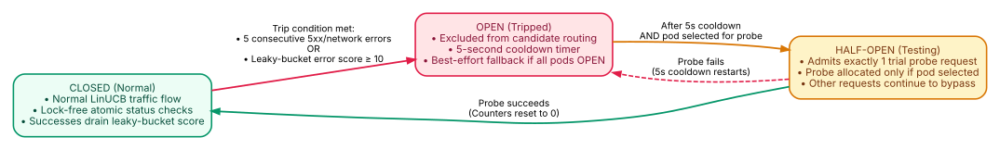

# 7. Safety nets

**What you'll learn:** the protections that stop a learning router from doing
something silly: the circuit breaker, the least-connections fallback, and the other
guard rails you've already met in passing.

A model can be wrong, slow, or starved of data. Janus doesn't rely on it being
right. Several simple, boring mechanisms sit around it.

---

## The guard rails at a glance

| Guard rail | Protects against | Where it's explained |
| --- | --- | --- |
| **Circuit breaker** | Sending traffic to a pod that keeps failing | Below |
| **Least-connections fallback** | The model being too slow (over 1.5 ms) or having nothing to offer | Below |
| **Minimum exploration (20 requests)** | A new pod never being tried | [Page 2](02-how-janus-learns.md) |
| **Soft score penalty** | Noisy scores piling all traffic onto one pod | [Page 4](04-life-of-a-request.md) |
| **Reward is 0 for any 5xx** | The model learning that an erroring pod is fine | [Page 3](03-what-janus-measures.md) |
| **Promotion gates** | A slow pod being promoted just because it has many observations | [Page 5](05-pods-and-lifecycle.md) |
| **Bounded queue that drops** | Learning slowing down real requests | [Page 4](04-life-of-a-request.md) |
| **Feature cap and `γ` range** | Accidental cost blow-ups or numerical overflow | Pages 2 and 6 |

---

## The circuit breaker

Code: `linucb-proxy/internal/circuitbreaker/cb.go`.



Every backend has a circuit breaker, wired into every routing path. HTTP 5xx
responses and connection failures count against it. It has three states, like a
household fuse:

```
        too many errors
CLOSED ─────────────────▶ OPEN
  ▲                         │
  │  probe succeeds         │ after a 5 s cooldown
  │                         ▼
  └──────────────────── HALF-OPEN ── probe fails ──▶ back to OPEN (cooldown restarts)
```

| State | What it does |
| --- | --- |
| **Closed** (normal) | Requests flow through LinUCB. The breaker trips on **5 errors in a row**, or when a **leaky-bucket** error score reaches 10 (each error adds to the score and each success drains it), so a pod that fails often but not consecutively, like one returning 503 on every fifth request, is still caught |
| **Open** | The backend is excluded **while alternatives remain eligible**. After a 5-second cooldown it may get one recovery probe. If *every* backend is open, Janus still routes best-effort rather than refusing all traffic |
| **Half-open** | A single trial request is admitted. Success closes the breaker; failure re-opens it and restarts the cooldown |

Recovery probes are reserved only after the backend has actually been selected, so a
probe isn't wasted on a pod that wouldn't have been chosen.

### How it stays lock-free

The breaker is built from atomics, so asking "may I send a request here?" on every
request costs one atomic read:

```go
type CircuitBreaker struct {
    consecutiveErrors atomic.Int64
    errorScore        atomic.Int64  // leaky-bucket error accumulator
    state             atomic.Int32  // 0=Closed, 1=Open, 2=HalfOpen
    lastTrip          atomic.Int64  // Unix nanoseconds
    maxErrors         int64
    cooldown          time.Duration
    now               func() time.Time  // injectable for tests
}
```

When the cooldown ends, many goroutines may notice at once. Only one should send the
probe. A **compare-and-swap** settles it: the first goroutine atomically changes the
state from Open to Half-open and wins; the rest see "no" and carry on:

```go
case StateOpen:
    elapsed := cb.now().Sub(time.Unix(0, cb.lastTrip.Load()))
    if elapsed > cb.cooldown {
        return cb.state.CompareAndSwap(StateOpen, StateHalfOpen)
    }
    return false
```

### A testing detail you'll appreciate

The clock (`now`) is injected. Tests pass in a fake clock and jump past the cooldown
instantly instead of sleeping, which keeps the tests fast and deterministic.

### Why the breaker matters for the benchmark

The baselines in the benchmark have **no circuit breakers**. In the errors-fault
scenario Janus failed 0.07% of requests against about 5% for RR, LC and P2C. Much of
that gap is the breaker, not the learned routing. Keep this in mind whenever you read
that result.

---

## The least-connections fallback

Code: `linucb-proxy/internal/fallback/leastconn.go`.

If the LinUCB decision takes more than 1.5 ms, or nothing qualifies, Janus falls back
to **least connections**: send the request to the backend with the fewest requests in
flight. (Shadow traffic uses the same picker.)

### Why it's a good fallback

- **No model needed.** It works immediately, with no warm-up.
- **Self-correcting.** A slow pod's in-flight count stays high, so it is picked less.
- **Simple to reason about.** What it does is obvious from the counters.

### Acquire and release

```go
p.lc.Acquire(pod.ID)
defer p.lc.Release(pod.ID)
```

`defer` guarantees the counter goes back down even on an error or a panic. Without it,
a leaked count would make a pod look permanently busy.

### Why a mutex here?

The picker has to scan all pods and return the minimum, which is a read across
multiple keys at once. `sync.Map` only gives per-key atomicity, so a plain mutex around
a map is the correct tool. The fallback is rare, so contention is acceptable.

---

## What the safety nets don't cover

Janus has no retries or request hedging, no TLS/mTLS termination, and no
authentication on its admin endpoints (`/stats`, `/model`, `/metrics`, `/healthz`,
`/readyz` are served on the same port as client traffic). See
[known issues](known-issues.md).

---

[← Previous: Adapting to change](06-adapting-to-change.md) · [Documentation index](README.md) · [Next: The Rust core and FFI →](08-rust-core-and-ffi.md)
