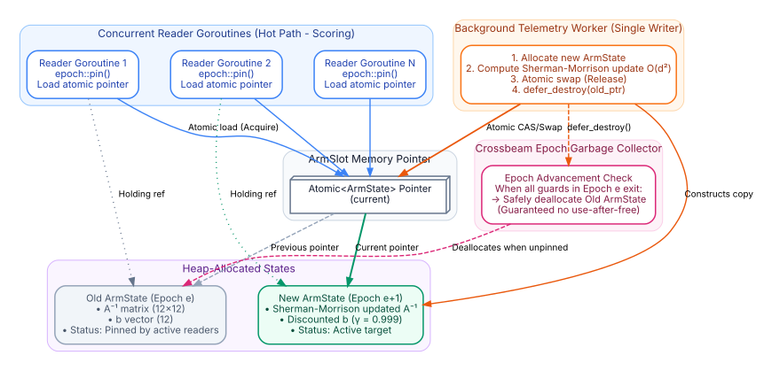

# 8. The Rust core and FFI

**What you'll learn:** how the model stays consistent while hundreds of requests read
it and a background worker writes it (without locks), and how Go safely calls into
Rust. This is the most technical page; skip it if you only operate Janus.

---

## Part A: lock-free state with RCU

### The constraint

The hot path (scoring) runs on every request, from many goroutines. The writer (the
update worker) changes the model. If the writer could change a pod's `A⁻¹` while a
reader was half way through using it, the reader would see a mixture of old and new
numbers, and routing would be quietly corrupted.

The obvious fix is a mutex. But under load, readers would queue behind each other and
behind the writer, and a garbage-collection pause in whoever holds the lock would
stall everything.

### The pattern: Read-Copy-Update (RCU)



RCU suits workloads with many readers and one writer. It has three steps:

1. **Read.** A reader takes a reference to the current data. No lock.
2. **Copy.** The writer builds a *new* copy with the update applied. The old one is never modified.
3. **Update.** The writer atomically swaps the pointer to the new copy, and schedules the old copy for deletion once nobody can still be reading it.

In Janus:

| Phase | Code | Where |
| --- | --- | --- |
| Read (hot path) | `ArmSlot::score()` | One atomic load, no lock |
| Copy | `ArmState::update_with_gamma()` returns a new `ArmState` | Background |
| Update | `ArmSlot::update()` swaps in the new state | Background |

**Guarantee:** a reader sees the old state or the new state, never a mixture. Each
`ArmState` holds `(A⁻¹, b)` together, so they always match.

### When can the old copy be freed?

Not immediately. A reader may have grabbed the old pointer a nanosecond before the
swap. Freeing it would be a use-after-free, the classic RCU bug.

Janus uses `crossbeam-epoch`, which tracks which "epoch" each thread is in. An old
object is freed only after every thread has moved past the epoch in which it was
replaced. The key pieces:

- `Atomic<T>`: a heap pointer that can be loaded and swapped atomically.
- `Owned<T>`: a uniquely owned pointer; swapping it in transfers ownership.
- `Guard` (from `epoch::pin()`): marks "this thread is active in this epoch".
- `guard.defer_destroy(ptr)`: free `ptr` once all current guards are gone.

```rust
pub fn update(&self, x: &DVector<f64>, reward: f64, gamma: f64) {
    let guard = &epoch::pin();
    let old_shared = self.current.load(Acquire, guard);
    let old = unsafe { old_shared.deref() };

    let new_state = old.update_with_gamma(x, reward, gamma);
    let new = Owned::new(new_state);

    let prev = self.current.swap(new, Release, guard);
    unsafe { guard.defer_destroy(prev); }   // deferred, never freed immediately
}
```

> **Never `free()` the old pointer right after the swap.** Always `defer_destroy`.

### Memory ordering, briefly

- **Release** (used by the writer): everything written before this store becomes visible to any thread that later sees it with an Acquire load.
- **Acquire** (used by readers): a load that sees a Release-written pointer is guaranteed to also see every write that happened before that Release.

Together they mean a reader that loads the new `ArmState` pointer sees it fully
initialised.

### Hot path versus background path

```rust
pub fn score(&self, x: &DVector<f64>, alpha: f64) -> f64 {
    let guard = &epoch::pin();                                        // cheap
    let state = unsafe { self.current.load(Acquire, guard).deref() };
    state.ucb_score(x, alpha)                                         // d² operations
    // no mutex, no allocation, no blocking
}
```

The writer's path costs one pin, one load, one allocation and ~d² arithmetic, one
swap and one deferred free. None of it blocks a reader.

### Numerical safety

- **Variance clamp.** `xᵀA⁻¹x` is never negative mathematically, but floating-point
  can produce `−1e-16`. The code uses `.max(0.0).sqrt()` so a tiny negative never becomes `NaN`.
- **Finiteness checks.** Every context vector entering the FFI is checked. A `NaN` or
  `Inf` would spread through matrix multiplication and permanently corrupt that arm.

---

## Part B: calling Rust from Go (FFI)

Go can't call Rust directly. It can call C. So Rust exposes a C-compatible interface,
and Go calls that through **CGO**.

### Step 1: speak C

By default Rust's calling convention can change between compiler versions. Marking a
function `extern "C"` opts into the stable C convention. `#[no_mangle]` stops Rust
from renaming the function, so the linker can find it by its plain name:

```rust
#[no_mangle]
pub extern "C" fn linucb_engine_new_with_gamma(/* ... */) -> *mut Engine
```

### Step 2: hide the internals (opaque handle)

Go receives a pointer to an `Engine` but can't see inside it:

```rust
pub struct Engine { arms: Vec<ArmSlot>, dim: usize, alpha: f64, gamma: f64 }   // Rust only
```
```c
typedef struct Engine Engine;   // C and Go see an empty declaration
```

Lifecycle:

```rust
Box::into_raw(Box::new(Engine { ... }))   // create: give ownership to a raw pointer
drop(Box::from_raw(engine))               // destroy: take it back and free it
```

The caller must call `linucb_engine_free` exactly once.

### Step 3: generate the header

`cbindgen` reads the Rust source and writes `include/linucb.h`. `build.rs` runs it at
build time. The header is committed, so Go builds don't need `cbindgen`.

### Step 4: link it

```go
// #cgo CFLAGS: -I${SRCDIR}/../../../linucb-core/include
// #cgo LDFLAGS: ${SRCDIR}/../../../linucb-core/target/release/liblinucb_core.a -ldl -lpthread -lm
import "C"
```

`-ldl`, `-lpthread` and `-lm` are the dynamic-loader, threads and math libraries that
Rust's standard library and `nalgebra` rely on.

### Static, not shared

The crate builds as `["lib", "cdylib", "staticlib"]`. The **static** `.a` is linked
straight into the Go binary, so there's no `.so` to ship, no `LD_LIBRARY_PATH`, and
the Docker image is just one binary.

**This is why you must build the Rust core before the Go proxy**: Go links
`liblinucb_core.a` at compile time.

### The three footguns

**1. A Rust panic must never cross the boundary.** Unwinding through C frames is
undefined behaviour. Every exported function wraps its body in
`std::panic::catch_unwind(AssertUnwindSafe(|| { ... }))` and returns a safe error
value (a null pointer, `NaN` or `-1`) if it panics.

**2. Empty slices.** `&s[0]` on an empty slice panics, and a zero-length raw slice is
a dangling pointer. The Rust side checks `x.is_null() || len == 0 || len != engine.dim`,
and the Go side checks `len(x) == 0` before taking `&x[0]`.

**3. Who owns which memory.** Rust frees Rust memory; Go's garbage collector manages
Go memory. Never mix them: Go must never call `C.free()` on the engine pointer, and
Go slices passed to Rust are only borrowed for the duration of the call (CGO keeps the
GC from moving them meanwhile).

### Errors without exceptions

`linucb_score` returns `f64::NAN` on failure. A score of `0` or `−1` could be a
legitimate (if bad) score, but `NaN` can't be. The Go wrapper checks `math.IsNaN`
and turns it into an error.

### A backstop for forgetting to close

Go's GC doesn't run C destructors. If an `*Engine` were collected without `Close()`,
Rust's memory would leak. `runtime.SetFinalizer` registers a backup that calls
`Close()`, and `Close()` clears the finalizer so it can't double-free.

### Type mapping

| Rust | C | Go (CGO) |
| --- | --- | --- |
| `*mut Engine` | `Engine *` | `*C.Engine` |
| `c_int` | `int` | `C.int` |
| `c_double` | `double` | `C.double` |
| `usize` | `size_t` | `C.size_t` |
| `*const c_char` | `const char *` | `*C.char` |

### Where the gamma fits

The forgetting factor travels through five layers; see the list at the end of
[page 6](06-adapting-to-change.md).

> **Known hazard.** `linucb_add_arm` grows the arm list with `Vec::push` from the
> discovery goroutine without synchronising against hot-path reads. A reallocation
> during concurrent scoring could race. See [known issues](known-issues.md).

---

[← Previous: Safety nets](07-safety-nets.md) · [Documentation index](README.md) · [Next: The Go proxy →](09-go-proxy-internals.md)
