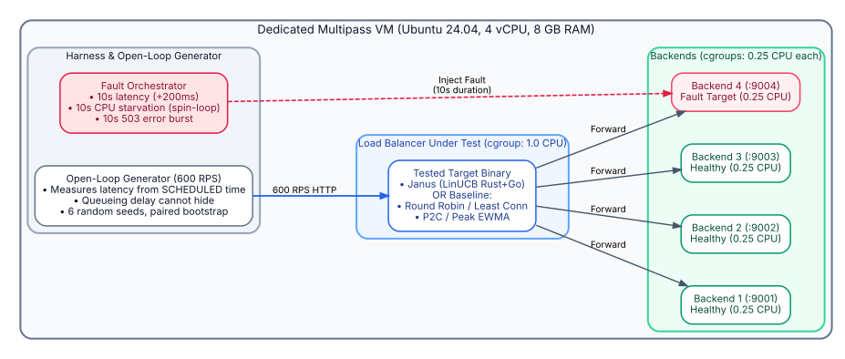

# 12. Testing and benchmarking

**What you'll learn:** how the code is tested, how the benchmark is designed so you can
trust (or challenge) it, what it measured, and how to run it yourself.

---

## Part A: the test suites

### Rust (`linucb-core/tests/`)

`src/` holds only engine code. Every test, the simulator and benchmarks live outside
it; each file in `tests/` is its own crate that uses only the public API.

| File | What it checks |
| --- | --- |
| `arm.rs` | Cold start and the Sherman-Morrison update |
| `rcu.rs` | RCU publication, reset, concurrent readers |
| `ffi.rs` | C ABI lifecycle and input validation |
| `convergence.rs` | In the simulator, after 500 requests a degraded pod gets under 10% of traffic |
| `numerical_stability.rs` | `max‖A⁻¹·A − I‖ < 1e-6` after 100,000 updates; windup bounds after long idle gaps |
| `common/` | The simulator plus its copies of the context vector and reward |

```bash
cd linucb-core && cargo test
```

### Go (beside the code)

```bash
cd linucb-proxy
go test ./...                 # everything, mock discovery
go test -tags k8s ./...       # also the Kubernetes discovery tests
go test -race ./...           # data-race detector; run it after concurrency changes
```

Reward invariants (always in `[0, 1]` over 5,000 random inputs, 5xx gives 0, never
rises as latency rises) are tested against the **production** reward in
`linucb-proxy/internal/proxy/reward_test.go`.

### Three testing habits in this codebase

**Table-driven tests.** One test, many cases, each runnable alone:

```go
cases := []struct{ name string; spec Spec; wantErr bool }{
    {"valid config", validSpec(), false},
    {"max dims too large", specWithDims(25), true},
}
for _, tc := range cases { t.Run(tc.name, func(t *testing.T) { ... }) }
// go test -run TestValidate/valid_config
```

**Interfaces for everything external.** Anything that touches the outside world sits
behind a small interface with a production and a mock implementation:

| Interface | Production | In tests |
| --- | --- | --- |
| `Source` (feature store) | Prometheus | `MockSource` with synthetic values |
| `Discovery` (registry) | Kubernetes EndpointSlices | `MockDiscovery` that sends add/remove events |

**A fake Kubernetes.** `discovery_k8s_test.go` uses `k8s.io/client-go/kubernetes/fake`,
an in-memory client with the same interface as the real one. Tests create fake
EndpointSlices and assert on the registry, with no cluster.

### Keep two reward copies in step

`reward.go` (production) and `linucb-core/tests/common/reward.rs` (simulator) must match.
There's no automatic check, so edit them together.

---

## Part B: the black-box benchmark

### Why a separate harness?

The question "does Janus beat the classics?" is easy to answer dishonestly: tune
Janus, leave the baselines alone, test on a friendly workload. So the benchmark in
`benchmark/` is built to resist that:

- It is a **separate Go module** that must not import `linucb-proxy` code.
- It runs the **production Janus binary**, as shipped, as a black box.
- The baselines (round robin, least connections, P2C, Peak EWMA) run in a small proxy with the same upstream transport settings.
- The **decision rule is frozen first**, in [`benchmark/PROTOCOL.md`](../benchmark/PROTOCOL.md), before any trial.
- Failed, overloaded or flagged trials **stay in the data**.

### The testbed



| Item | Value |
| --- | --- |
| Machine | Dedicated Multipass VM `janus-bench`, Ubuntu 24.04, 4 vCPUs, 2 GiB, cgroup v2 |
| CPU layout | vCPU 0: agent and system · vCPU 1: proxy (1.0 CPU, 512 MiB, `GOMAXPROCS=1`) · vCPUs 2–3: four backends at 0.25 CPU, 128 MiB each |
| Load generator | On the host, outside the VM |
| Backend work | 1 ms of CPU plus 1 ms sleep per request, up to 16 at once |
| Traffic | 600 RPS, open-loop at fixed intervals, every tenth request a 4 KiB POST; latency measured from each request's *scheduled* arrival, with a 2 s client timeout |

600 RPS is about 73% of the backends' CPU quota. An earlier 900 RPS healthy load
saturated them, so it measured overload rather than routing.

### The trials

Every trial starts a **fresh proxy process**, then:

1. Reset all backends to healthy.
2. **Warm up** for 30 s at 600 RPS.
3. Run a scenario:
   - **healthy:** 10 s.
   - **latency**, **errors** or **cpu:** 3 s healthy, then a 10 s fault on one backend, then a recovery phase (3 s in the frozen campaign, 30 s in the recovery study).

| Fault | What it does to one backend |
| --- | --- |
| latency | +200 ms on every request |
| errors | `503` on every fifth request |
| cpu | 50 ms CPU burn every 100 ms |

Grid: 5 policies × 4 scenarios × 6 seeds = **120 trials**. Order is shuffled per seed
(fixed RNG seed `20261109`) and the faulted backend rotates with the seed.

### The decision rule (frozen)

Against each baseline separately, using a paired bootstrap (20,000 draws, adjusted for
four baselines):

| Gate | Pass if |
| --- | --- |
| **Latency** | Janus/baseline fault-phase p99 ratio (geometric mean over latency and CPU scenarios) has an upper bound **below 0.85** |
| **Failure** | Error-scenario failure rate rises by **at most 0.1 point** |
| **Throughput** | Healthy achieved rate ratio **at least 0.97** |

A baseline is "beaten" only if all three pass and the run has no validity findings.

Validity checks flag (never filter): incomplete arrivals, generator schedule delay over
10 ms, missing or stale backend metrics, Janus telemetry drops, a CPU fault that didn't
raise throttling, Janus pods not all ACTIVE after warmup, and mismatched request counts.

### What it found

| Run | Date | Status | Janus passed all gates? | Recovery p99 vs RR / LC / P2C |
| --- | --- | --- | --- | --- |
| Frozen campaign, 3 s recovery | 2026-11-10 | Confirmatory | Yes, against all four | 1.9–6.5× worse |
| Recovery study, 30 s recovery | 2026-11-11 | **Exploratory** | Yes (re-checked) | 1.006 / 1.015 / 1.015× (on par) |

The 2026-11-11 numbers (median p99 in ms over six seeds, `fault / recovery`):

| Scenario | Janus | RR | LC | P2C | Peak EWMA |
| --- | --- | --- | --- | --- | --- |
| Healthy | 4.12 | 4.00 | 3.94 | 3.96 | 6.51 |
| Latency fault | **8.43** / 4.02 | 2001.8 / 4.02 | 14.14 / 3.99 | 203.5 / 4.04 | 29.38 / 19.62 |
| Errors fault | 9.49 / 4.08 | 3.96 / 3.97 | 3.99 / 3.94 | 4.02 / 3.95 | 5.87 / 6.11 |
| CPU fault | **6.96** / 3.98 | 246.4 / 4.05 | 95.4 / 4.00 | 98.2 / 3.93 | 31.14 / 16.36 |

The full tables, intervals and caveats are in
[history, part 2](history/04-frozen-campaign-and-recovery.md).

### Measured against the original targets

| Target | Status |
| --- | --- |
| Routing decision p99 under 1.5 ms | **Not measured** by this benchmark |
| Sherman-Morrison update under 50 µs at 12 features | Measured 436 ns in September 2026; no benchmark kept |
| Numerical stability `< 1e-6` after 100k updates | Automated test |
| p99 reduction vs round robin under fault (> 15%) | Met: 0.011× RR's fault p99 (but see the RR caveat below) |
| Throughput within 3% of baseline | Met: healthy 599.9 RPS, ratio 1.000 |
| Memory per arm under 12 KB | Checked by design (`sizeof(ArmState)`) |
| Convergence under 500 requests | Simulator test |

### How to read the results honestly

- **The baselines have no circuit breakers; Janus does.** The failure-rate gap measures the breaker as much as the routing.
- **The RR ratio is set by RR's 2-second timeouts**, not by a measured tail.
- **Janus loses the errors-fault p99** (about 9.5 ms vs about 4 ms) and takes longer to readmit a recovered pod (2.25 s vs 1.0 s after a latency fault). It also uses about 25–33% more proxy CPU per request.
- **The testbed rewards Janus's design:** evenly spaced arrivals, tight CPU quotas where throttling dominates the baselines' tails, identical requests, and short faults. Janus was tuned on this testbed.
- **The recovery result is exploratory:** fixes written after seeing the first results, no repeat run, no correction for extra comparisons, and a Janus binary built from the working tree as it stood on 2026-11-11.
- **Not covered:** bursty or Poisson arrivals, multi-host networking, Kubernetes discovery, long runs, real traffic.

---

## Part C: run it yourself

Requirements: a Multipass VM with cgroup v2, systemd and curl, plus the build tools from
[page 10](10-running-janus.md).

```bash
multipass launch 24.04 --name janus-bench --cpus 4 --memory 2G --disk 8G

benchmark/run.sh janus-bench /absolute/path/to/NEW_RESULTS_DIRECTORY
python3 benchmark/analysis/plot.py /absolute/path/to/NEW_RESULTS_DIRECTORY/canonical   # needs matplotlib
```

`run.sh` refuses to overwrite an existing directory, builds everything, copies it to the
VM, runs **one short preflight trial** and stops if it is flagged, then runs the grid.
It currently uses a 30 s recovery phase and copies `PROTOCOL-recovery.md` into the
results directory. The frozen campaign (2026-11-10) used a 3 s recovery phase (`driver -recovery=3s`) and the Janus code as it stood before the recovery changes described on [page 6](06-adapting-to-change.md). Set `JANUS_BENCH_TIMEOUT` (default `180m`) to change the time limit.

The analysis exits with status 2 if the grid is incomplete or any trial is flagged,
but it still writes `analysis.json` and `report.md`. Recovery phases longer than 3 s
are labelled **exploratory**.

Test the harness itself with:

```bash
cd benchmark && go vet ./... && go test ./...
```

### Where the results live

`benchmark/runs/20261110/` (frozen) and `benchmark/runs/20261111/` (recovery study),
each with `canonical/trials.jsonl`, per-phase CSVs, `analysis.json` and `report.md`.

---

[← Previous: Troubleshooting](11-troubleshooting.md) · [Documentation index](README.md) · [Next: Reference →](13-reference.md)
