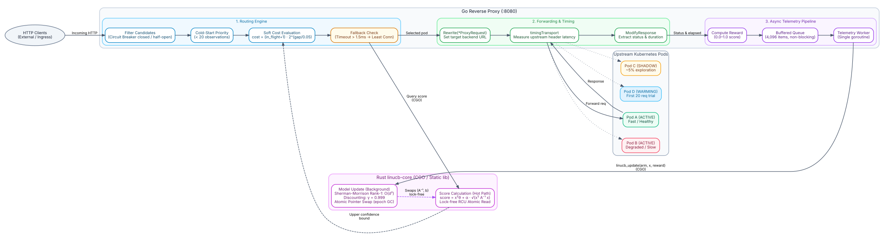

# Janus documentation

Welcome. These pages walk through Janus from "what is this?" to "how do I run it,
and what is still broken?". Each page stands on its own, but they are written to be
read in order, and each one ends with a link to the next.

If you only have five minutes, read the [root README](../README.md). If you have an
afternoon, start at page 1.

## Pick a path

| I want to… | Start here |
| --- | --- |
| Understand what Janus is and why it exists | [1. The big picture](01-the-big-picture.md) |
| Follow the algorithm without drowning in maths | [2. How Janus learns](02-how-janus-learns.md) |
| See exactly what it measures and how it scores a response | [3. What Janus measures](03-what-janus-measures.md) |
| Trace one request from arrival to learning | [4. The life of a request](04-life-of-a-request.md) |
| Understand how new pods are welcomed | [5. Pods and their lifecycle](05-pods-and-lifecycle.md) |
| Know why it recovers (or doesn't) after a fault | [6. Adapting to change](06-adapting-to-change.md) |
| See what protects you when something goes wrong | [7. Safety nets](07-safety-nets.md) |
| Read the Rust, FFI and concurrency details | [8. The Rust core and FFI](08-rust-core-and-ffi.md) |
| Read the Go proxy details | [9. The Go proxy](09-go-proxy-internals.md) |
| Run it locally, in Docker or on Kubernetes | [10. Running Janus](10-running-janus.md) |
| Fix something that isn't working | [11. Troubleshooting](11-troubleshooting.md) |
| Check how it was tested and benchmarked | [12. Testing and benchmarking](12-testing-and-benchmarking.md) |
| Look up a file, term or flag | [13. Reference](13-reference.md) |
| See what is still broken | [Known issues and risks](known-issues.md) |
| Read how we got here, failures included | [History](history.md) |

## The whole system on one page



```
 client ──▶ Janus proxy (Go) ──▶ one of your backend pods
                │      ▲
                │      └── scores each pod with the LinUCB model (Rust)
                │
                └── after each response: measure it, give it a 0–1 reward,
                    and teach the model (in the background)
```

Three ideas carry most of the weight:

1. **Every pod is an "arm" with its own small model** that predicts how well that pod will do right now.
2. **Scores soften load; they don't forbid it.** A pod that looks worse just gets less traffic.
3. **Everything slow happens in the background.** The routing path only reads; learning happens elsewhere.

## About these pages

- Page numbers are stable; the older single-file `architecture.md` now points here (see the [map](architecture.md)).
- Numbers quoted from benchmarks come from [`benchmark/runs/`](../benchmark/) and are explained, with their limits, in the [history](history.md).
- Found a mistake? These docs are checked against the code, but code moves. The code wins; please fix the page.
